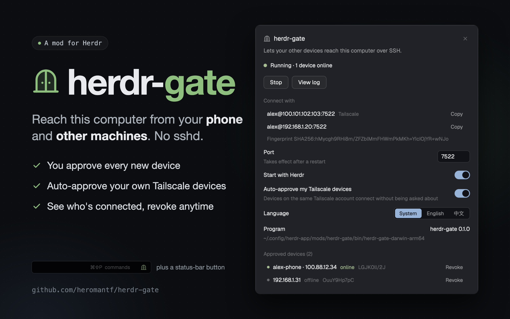

# herdr-gate

A panel and a status-bar button for herdr-gate, a small SSH server that lets Herdr's
desktop and phone apps reach this machine without the system's sshd. In the panel you
start and stop it, see what to type on the other device, approve a device that knocks and
revoke one later. The button shows whether it runs, how many devices are connected, and
when one is waiting.

## Before you add it

The mod is only the controls. The server is the `herdr-gate` program (Go, in the same
repository), which the mod runs.

- **It starts an SSH server** when you click Start, and each time Herdr opens once Start
  with Herdr is on. A device you approve there can run any command as you.
- **It reaches the network** only when you click Download: for the program, from this
  repository's newest GitHub release, through the system's proxy when one is set.
- **It runs programs**: `hc`, `herdr-gate`, `curl`, the system's shell (`sh`, `cmd`),
  `chmod`, `uname`, `xattr`, `scutil`, `reg` and `defaults`. What each is for is under
  Built from.
- **It reads** `~/.config/herdr-gate/connections.json`.

## What you see

**The panel** (a dialog, 520 wide, padding 18, the theme's popover color), top to bottom:

- A title row: the gate icon (16, muted), "herdr-gate" (15, semi-bold), a ✕ at the right.
- One muted line (13) saying what it is for.
- A status line: an 8px dot and a sentence. Dim and "Not running"; green and "Running",
  with the number of devices online when there are any; the theme's blocked color and
  "A device is waiting for approval".
- A device at the door, only while one waits: a card tinted with the blocked color,
  holding the gate's own words (where it connects from, its key's fingerprint) and two
  buttons, Allow (filled) and Deny.
- Buttons (30 high, radius 7): Stop and View log while it runs, Start (filled) otherwise.
  Beside them, small muted text while a click is being carried out.
- "Connect with": one row (30 high) for each of this machine's addresses, four at most,
  as `user@address:port`, a dim "Tailscale" after the one Tailscale gave it, and Copy at
  the right. Under them the machine's fingerprint, small and dim.
- Settings, title left and control right: Port (a 76-wide input, its border in the
  blocked color while what is typed is not a port, with a line under the title), Start
  with Herdr (a switch), Auto-approve my Tailscale devices (a switch, with a line under
  the title, which says so when Tailscale gave this machine no address), Language (three
  choices side by side: System, English, 中文; the chosen one filled with the accent
  color). Last, a row about the gate program itself: "Program", its version at the right,
  and under them the path it lies at, dim.
- "Approved devices (n)": rows (30 high) with a 6px dot, the device (its Tailscale name
  when it was approved automatically, and where it connects from), online or offline, the
  first ten characters of its fingerprint, and Revoke. Revoke asks once more in a row
  underneath. The list scrolls past 190px.

**The log page**, in place of the above and exactly as tall: a title row with Back and
✕, then the gate's own output as text, 12px, one line each (22 high), never wrapped. It
scrolls both ways with the scrollbars always shown, opens at the newest line, which is at
the bottom, and follows it.

**Without the program**, the panel shows only the title, the line of purpose, a sentence
that the program for this computer is not here yet, that Download gets the newest
release's, a filled Download button, and a dim line naming the file and the folder to put
one into by hand.

**The status-bar button** (a block in a layout's status bar, drawn like Herdr's own: the
chrome color under a 1px top border, text 11.8): the gate icon (14) at the right edge of
its block. Dim when the gate is stopped, green while it runs,
followed by "n online" while devices are connected; in the blocked color and blinking,
followed by "Approval needed", while one waits. The block is 34px wide for the icon
alone, 100 with a count, 150 with the sentence.

## How it behaves

- Start runs the gate in a terminal of herdr-core that has no pane, named `herdr-gate`;
  Stop ends that terminal. The gate keeps running when the window or any tab closes.
- A waiting device comes from the gate's own status report: its terminal turns
  "blocked", and the report's title and message are what the card shows. Allow and Deny
  answer in that terminal. The button notices too, and posts a toast (once for each new
  device) that opens the panel when clicked, with the "needs you" sound if sounds are on.
- Clicking the button opens the panel.
- Copy puts the row's text on the clipboard and reads "Copied".
- Port: typing a valid number stores it; it is used at the next start. While the gate
  runs on another port, a Restart link appears beside the input.
- Start with Herdr: the button starts the gate once each time Herdr opens, when it is on
  and no gate runs. Someone who stopped it by hand finds it stopped.
- Auto-approve: asks the gate program to switch it; a running gate follows at once.
- Language changes the panel and the button at once. A running gate keeps the language it
  was started with, so then a line under the title says so and offers Restart.
- Revoke, confirmed, takes the device off the gate's list; a running gate drops its
  connection within seconds.
- View log shows the last 200 lines and reads again every two seconds. Esc or Back
  returns; Esc on the main page closes the panel.
- Download fetches this system's program from the newest release into the mod's `bin/`;
  the panel then becomes the ordinary one. A program put into `bin/` by hand does the same.
  While it downloads, small muted text beside the button says how far it is and how fast:
  "Downloading… 48% · 2.6 MB of 5.3 MB · 2.6 MB/s", read once a second.
  A dim line under the button asks to keep the panel open until it is done. When it
  fails, what curl said shows there in the blocked color.
- The panel reads the gate's state again when the gate's folder changes, and every five
  seconds; the button counts connections when that folder changes, and every fifteen.

## Built from

- `mods/herdr-gate/mod.json`: `{ "place": "none", "title": "herdr-gate", "overlay": { "kind": "dialog", "width": 520 } }`.
  `main.js` picks the view by `props().role`: `"launcher"` is the button, anything else
  the panel. `gate.js` holds what both share. `gate.svg` is the icon (a 24px outline,
  tinted by `text_color`).
- The button, in a layout's status bar:
  `{ "id": "herdr-gate", "type": "block", "size": { "px": 34 }, "content": { "mod": "herdr-gate", "props": { "role": "launcher", "block": "herdr-gate" } } }`.
  It resizes its own block with `layout.resize`; the panel opens with `mod.open`.
- From `herdr`: `hc`, `exec`, `terminals`, `machines`, `shared`/`setShared`
  (`herdr-gate.autostart`, `.port`, `.language`), `readTextFile`, `watchFolder`, `notify`,
  `playSound`, `settings`, `fonts`, `theme`, `props`, `closeOverlay`, `run`, `home`,
  `appHome`, `window`. From `fs/promises`: `exists`, `unlink`.
- `hc run --json --bg --no-parent --name herdr-gate --cwd ~ -- <program> -listen :<port> [-lang en|zh]`,
  `hc kill --json <t>`, `hc send --json --force <t> y|n`, `hc read <t> --lines 200`.
- The gate program: `-info` (JSON: version, language, account, addresses, Tailscale's
  among them, fingerprint, the switch, devices, connections), `-revoke <key>`,
  `-auto-approve on|off`. It lies in the mod's `bin/` as `herdr-gate-<os>-<arch>`
  (`.exe` on Windows), built there by the repository's `build.go`, downloaded from
  `releases/latest/download/`, or put there by hand.
- System programs, each run with `exec`: `uname -m` when the script is not told the
  machine's kind; `chmod +x` and, on macOS, `xattr -d com.apple.quarantine` on the
  program before its first use; for a download `curl --fail --location --show-error
  [--proxy …] --output <part> <address>`, then `sh -c 'mkdir -p … && mv -f …'` or
  `cmd /d /c mkdir … & move /y …`; for the proxy `scutil --proxy`, or `cmd /d /c set`
  and `reg query` of the Internet Settings; for the language without a program
  `defaults read -g AppleLanguages`, `reg query` of the display languages, or the locale
  variables through `sh`.
- The close glyph is Herdr's own, `mods/workspace-chrome/x.svg`.

## Watch out

- Herdr rings only for terminals that have a pane, and closing a pane ends its terminal.
  So the gate has no pane, and the button does the announcing. No `--keep` either: after
  a core restart a kept terminal comes back as a shell under the same name, which would
  pass for a running gate.
- `hc send` refuses a program that reported "blocked" unless given `--force`.
- Anything written into the mod's own folder makes Herdr start the mod afresh about a
  tenth of a second later, cutting short whatever it was doing. So a download waits
  outside the mod's folder until it is whole, and one system command then moves it in.
- A program run with `exec` gives nothing back until it ends. So curl writes its progress
  meter to a file beside the download, and the panel reads the last state of the one
  line curl keeps rewriting there; what curl says when it fails is in that file too. On
  Windows a file curl opens itself (`--stderr`) cannot be read by anyone until curl ends,
  so there cmd opens it (`cmd /c curl … 2> file`). A state has nine to twelve words:
  newer curls leave a time they do not know blank where older ones write `--:--:--`.
- curl takes a proxy from its environment, not from the system's settings. A Herdr opened
  from the macOS desktop has no such variables, and on Windows only someone who saved
  them has. The mod then asks the system, `scutil --proxy` on macOS and the Internet
  Settings in the registry on Windows, and hands curl what it finds (`--proxy`).
- The download belongs to the open panel. Closing the panel leaves curl running to its
  end, or to the ten minutes Herdr lets a program run, but nothing then puts the file in
  place: what came stays beside the mods as `herdr-gate-download.part`, with
  `herdr-gate-download.progress`, until the next download.
- A file's bytes do not survive a trip through the script: `createHash` gives the sum of
  nothing for what `readFile` returned, and writing those bytes back makes another file.
  The program is downloaded and moved by system tools.
- `on_size_change` reports the size with the person's zoom applied; the log page divides
  by `settings().zoom` to be as tall as the main page.
- There is no plain scroll handle to send a list to its end. The log is a
  `v_virtual_list` with a `VirtualListScrollHandle` inside a sideways-scrolling area that
  is told how wide the longest line draws, since a script cannot measure text.
- `window()` is null during `herdr-app check`, which draws one frame and runs none of the
  panel's later work: it proves the mod loads, not that it works.
- The mod learns which language the system speaks by asking the gate program (`-info`),
  so it is English until that answers. With no program to ask, the panel asks the system
  itself, the way the program would.
- While Chinese is shown the whole mod is set in the first of Microsoft YaHei UI,
  PingFang SC, Noto Sans SC, Noto Sans CJK SC and Source Han Sans SC the system has:
  Herdr's own font leaves Chinese to whatever the system falls back on.
- On Windows the program cannot be replaced while the gate runs. On a Mac with Apple
  silicon a program copied over a running one is ended by the system when it next starts.
- It assumes `hc` is installed, and that the person adds the button to a layout of their
  own: without it there are no notifications, no start with Herdr and no count.

## Done when

- With no program present, the panel offers Download; while it runs the line beside the
  button counts up, with the speed; after it, the ordinary panel shows.
- Start turns the dot green and lists the addresses; Stop turns it dim; closing the
  panel, a tab or the window leaves a running gate running.
- A new device that connects makes the button blink "Approval needed" and a toast appear;
  Allow lets it in and it shows as online, in the panel and as "1 online" on the button.
- Revoke, confirmed, cuts that device off within seconds and removes its row.
- With Auto-approve on, a device on the same Tailscale account gets in unasked and is
  listed under its Tailscale name.
- The log page opens at its newest line and is exactly as tall as the main page.
- Choosing English or 中文 changes every word of the panel and the button at once.
